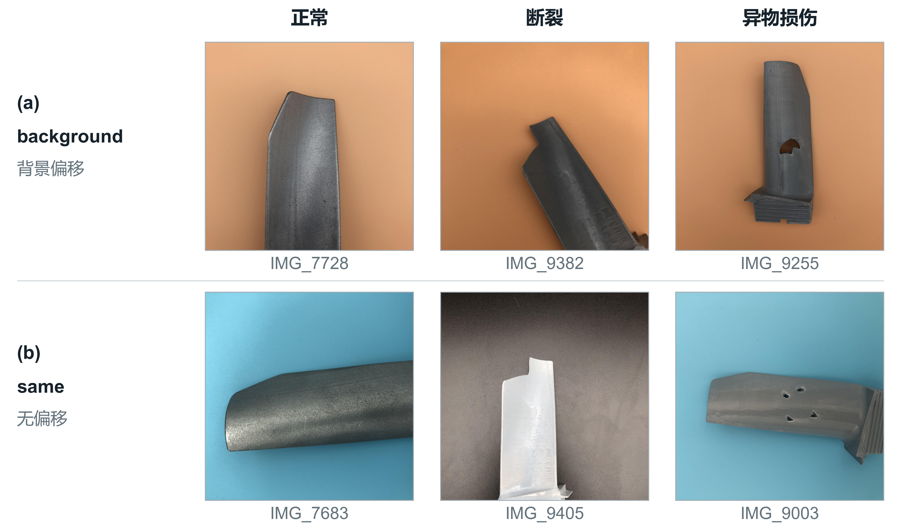
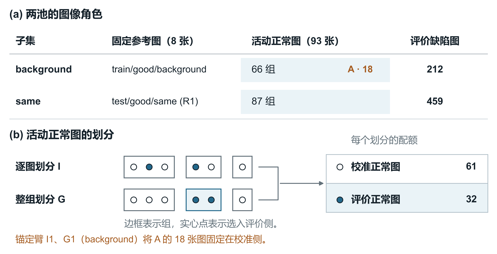
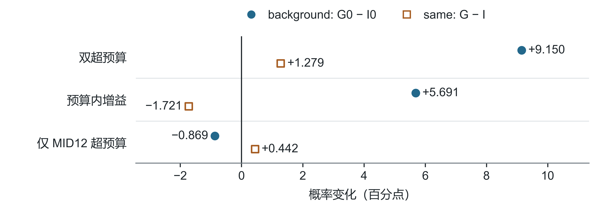
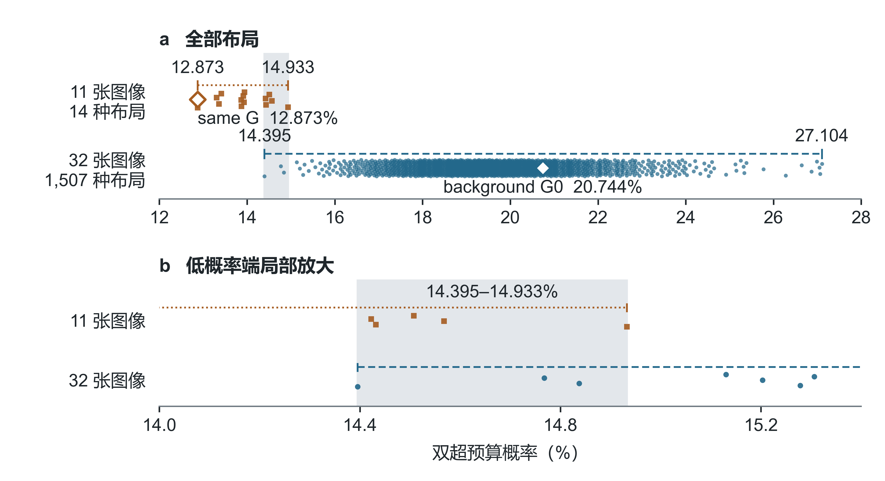

# 少样本异常检测中的整组划分与误报预算：两个固定分数池的精确计数

**初稿 v0**｜2026-11-19 起稿，2026-11-24 精修图件｜实验数据与精确计数结果见附录 B。

---

## 摘要

本文量化近重复图像整组分配对少样本异常检测误报预算的影响。我们固定 AeBAD-S 背景偏移子集（background）与无偏移子集（same）中的图像分数。每次将 93 张正常图分为 61 张校准图与 32 张评价图，最多允许 1 次误报。对校准最高分（MAX）和校准最高两分的中点（MID12）两个阈值，精确计数各结果对应的合法划分。

在未固定校准组的比较中，从逐图划分改为整组划分后，两个阈值同时超预算的概率在 background 从 11.59% 升至 20.74%，在 same 从 11.59% 升至 12.87%。当最高分和次高分图像各为单例组，且次高分严格大于第三高分时，该概率等于由组大小决定的生成函数系数之比。两池均满足这些条件。same 中仅 MID12 超预算的概率上升 0.44 个百分点。MID12 在预算内比 MAX 多检出缺陷的概率在 background 上升 5.69 个百分点，在 same 下降 1.72 个百分点。这些变化对应所研究的两个固定分数池。

**关键词**　少样本异常检测、误报控制、分组划分、精确计数、评测协议

## Abstract

We quantify how keeping near-duplicate images together changes false-alarm budget outcomes in few-shot anomaly detection. We fix image scores in two AeBAD-S pools, the background-shift subset (background) and the unshifted subset (same). Each allocation splits 93 normal images into 61 for calibration and 32 for evaluation, with a budget of one false positive. We count all legal allocations for two thresholds, the largest calibration score (MAX) and the midpoint of the two largest (MID12).

Without a group reserved for calibration, whole-group assignment raises the probability that both rules exceed the budget from 11.59% to 20.74% in background and from 11.59% to 12.87% in same. When the two highest-scoring normals are singletons and outrank the third, this probability is a ratio of generating-function coefficients determined by the group sizes. Both pools meet these conditions. In same, the probability of MID12-only exceedance rises by 0.44 percentage points. The probability that MID12 detects more defects than MAX while meeting the budget rises by 5.69 percentage points in background and falls by 1.72 in same. These changes describe the two fixed pools.

**Keywords**　few-shot anomaly detection, false-alarm control, grouped splitting, exact counting, evaluation protocol

---

## 1 引言

### 1.1 问题

工业异常检测常用已确认的正常样本设定阈值，对分数超过阈值的图像发出报警。逐图划分可能将近重复图像分到校准侧和评价侧。例如，一张高分校准图可能抬高阈值，使评价侧的对应图像未触发报警。是否发生取决于两张图像的分数和阈值规则。

整组划分将每组图像分到同一侧。即使检测器和逐图分数固定，可选的校准集与评价集仍会改变。本文比较从 93 张正常图中选出 32 张评价图的两种方式。在最多允许 1 次误报的预算下，单张高分正常图的归属就可能决定预算是否满足。

### 1.2 研究范围与贡献

本文给出四类结果的精确计数方法，区分超出误报预算与在预算内多检出缺陷。在两个 AeBAD-S 分数池均满足的排序条件下，两条规则同时超预算等价于两个特定单例组同时进入评价集。生成函数给出各组大小下的概率，并可量化备选布局的敏感性。两池的比较显示，在相同的预算与阈值规则下，预算内增益的变化方向可能相反。

---

## 2 相关工作与定位

表 1 列出与少样本评分、总体误报校准及参考库污染相关的研究。本文固定评分方法，考察合法的校准与评价划分如何改变图像级阈值的结果。

**表 1** 相关工作与本文的研究范围

| 工作 | 研究主题 | 与本文的关系 |
|---|---|---|
| AnomalyDINO（WACV 2025）[2] | 用 DINOv2 冻结特征做少样本异常检测，无需逐类训练 | 提供固定评分管线 |
| 分布无关误报校准（2026 预印本）[5] | 研究正常样本阈值与样本量限制 | 为 §3.4 区分总体误报率与有限池经验预算提供依据 |
| When More References Hurt（2026 预印本）[6] | 研究缺陷混入参考库 | 关注缺陷混入参考库的风险。本文关注校准与评价时近重复正常图的归属 |

---

## 3 协议

### 3.1 池与角色

AeBAD-S 收录在模拟检测环境下拍摄的航空发动机单叶片图像，试验使用真实发动机叶片或 1∶1 复制件。训练图像涵盖多个拍摄位置和黑、灰、蓝三种背景。原论文按四类缺陷标注图像，分别为异物损伤（`breakdown`）、高温气流导致的烧蚀（`ablation`）、表现为叶片局部缺失的断裂（`fracture`），以及与循环应力相关的叶缘沟槽（`groove`）。[1]

本文使用 `AeBAD_S` 的两个官方测试子集[1]。按原论文的定义，`same` 的正常样本与官方训练正常总体同分布，是无域偏移子集。`background` 通过改变图像背景引入域偏移。两者都含 `good` 正常图与 `ablation`、`breakdown`、`fracture`、`groove` 四类缺陷图。

本地目录计数与文献[1] 表 1 的训练集总数及测试集 8 项计数一致。训练集有 521 张正常图（`background` 265、`illumination` 62、`view` 194）。测试正常图/缺陷图分别为 `same` 230/459、`background` 93/212、`illumination` 75/198、`view` 92/280。两池的缺陷均纳入评价，正常图按表 2 分配角色。AeBAD 数据集由 Zhang 等[1]发布，原始图像文件未改动。数据采用 [CC BY 4.0](https://github.com/zhangzilongc/MMR/blob/master/LICENSE-DATASET)，配套 MMR 代码采用 [Apache-2.0](https://github.com/zhangzilongc/MMR/blob/master/LICENSE)。

两池均使用 8 张参考图和 93 张活动正常图。表 2 给出图像的角色与评分清单规模。

**表 2** 两个分数池的构造

| 项 | `background` | `same` |
|---|---|---|
| 参考图（8）来源 | `train/good/background` | `test/good/same` 内切（R1） |
| 活动正常图 `U` | 93（66 个 dHash≤4 组） | 93（87 组） |
| 校准 / 评价正常图 | 61 / 32 | 61 / 32 |
| 所列来源的未用正常图 | 257 张训练侧 background 正常图 | 129 张储备正常图 |
| 活动池内的参考近邻组 `A` | 18 张，含于 `U`；I1/G1 固定校准 | 无；2 张参考闭包内的非参考图计入储备 |
| 缺陷图（TP 分母） | 212 | 459 |
| 评分清单行数 | 313 行（305 查询 + 8 参考） | 560 行（552 查询 + 8 参考） |

`background` 的参考图来自 train。按官方说明，train 与 test 的同名子集并不相同——`background`、`illumination`、`view` 三个子集在测试侧均为训练未见[1]，因此这 8 张参考处在偏移前的域，与该池被评价的 test 正常图不同域。其活动池包含 18 张与参考图内容近邻的 test 正常图，这些图构成一个 dHash≤4 连通分量 `A`。`same` 的 8 张参考图从 `test/good/same` 内切，参考闭包中的 2 张非参考正常图计入储备。8/61/32 统一了两套设计的角色规模，但两池在官方设计上分属无偏移与背景偏移两个子集，加之参考来源、锚定集合与缺陷分母不同，跨池差异仅作描述性比较（见 §6.4）。

图 1 展示两个官方测试子集中的正常图及两类缺陷样本。



**图 1** AeBAD-S 测试图像示例。（a）背景偏移子集 `background`。（b）无偏移子集 `same`。每行从左至右为正常、断裂与异物损伤。各子图下方标注原始图像编号。图片来自 Zhang 等[1]发布的 AeBAD-S 数据集，采用 [CC BY 4.0](https://creativecommons.org/licenses/by/4.0/)，仅作等比例缩放。

### 3.2 分组与臂

将正常图转为灰度图，用双线性插值缩放至 9 × 8 像素。逐行比较相邻像素亮度，得到 64 位差分哈希（dHash）。将哈希值相差不超过 4 位的图像连边，按连通分量分组。`background` 活动池有 66 组（61 个单例和大小为 2、3、3、6、18 的五组）。`same` 先在全部 230 张测试正常图上建图，再将连通分量与活动池取交集，保留经储备图形成的传递连接，得到 87 组（82 个单例、4 个两图组和 1 个三图组）。

在 `same` 中，93 张活动图之间只有 3 条直接近邻边。5 个多图组中有 2 个仅经储备图连通。若仅在活动图上建图，则得到 90 组（87 个单例与 3 个两图组）。按 §5.3 的闭式计算，双超预算概率从 12.872993% 降至 12.186741%，减少 0.686252 个百分点。作为参照，仅 MID12 超预算的臂间差值为 +0.441996 个百分点（§5.2）。全池建图规则在 `same` 评分前冻结。



**图 2** 分数池构造与划分规则。（a）两池的固定参考、活动正常图与缺陷图。`same` 的储备图可将活动图连入同一组。（b）边框表示组，实心点和空心点分别表示评价和校准。逐图臂 I 可以拆分一个组，整组臂 G 将同组图像分至同一侧。每次划分使用 61 张校准正常图和 32 张评价正常图。`background` 的锚定臂 I1 与 G1 将 `A` 的 18 张图固定在校准侧。

**表 3** 臂定义与分配数

| 臂 | 选择单元 | 评价图数 | 锚定条件 | 合法划分数 |
|---|---|---:|---|---:|
| I0 / I | 单图 | 32 | 无 | C(93,32) = 8661069563374624785150762 |
| G0 / G | 整组 | 32 | 无 | `background` 1672489259948266974 / `same` 227171998760621646929754 |
| `I1`（仅 background） | 单图（75 张） | 32 | `A` 固定校准侧 | C(75,32) = 1560606121612265215950 |
| `G1`（仅 background） | 组（65 组） | 32 | `A` 固定校准侧 | 1672464128242708178 |

各臂的评价候选见图 2，合法划分数见表 3。在同一池的未锚定比较中，整组臂的均匀分布等于逐图臂在所有组均保持完整这一条件下的均匀分布。`background` 的主要比较为 G1 对 I1。跨池描述性比较使用未锚定臂，即 `background` 的 G0 对 I0 与 `same` 的 G 对 I。

### 3.3 规则族与四态

每行划分按表 4 的规则从 61 个校准分数 `x_1 ≤ … ≤ x_61` 求阈值，再用 32 个评价正常分数与全部缺陷分数判定结果。

**表 4** 阈值定义与四态判定顺序

| 项 | 定义 |
|---|---|
| MAX | `x_61` |
| MID12 | `(x_60 + x_61) / 2`（先加后除） |
| 报警 | `score > threshold`（严格大于） |
| FP / TP | 评价正常图中报警数 / 缺陷中报警数；分母 32 / \|D\| |
| 判序 | `FP(MAX)≥2 → both_over`；否则 `FP(MID12)≥2 → mid_over`；否则 `ΔTP>0 → budget_gain`；否则 `budget_no_gain` |

误报预算为 FP ≤ 1。令 ΔTP = TP(MID12) − TP(MAX)，表示阈值由 MAX 降至 MID12 后多检出的缺陷数。两条规则均满足预算时，按 ΔTP 是否大于零区分预算内增益与预算内无增益。

### 3.4 合法划分的精确计数

同一臂内各合法划分等概率。将活动正常图按分数降序排列，同分时按图像键排序。每个划分由校准侧排名最靠前的两张图确定所属类别。给定这两张图后，排在第二张之前且不属于该图对的正常图必须进入评价侧。整组臂对相应整组施加归属约束。若某组被要求同时进入两侧，或固定校准组被要求进入评价侧，则该类别没有合法划分。

给定最高两张校准图后，MAX 与 MID12 阈值确定。可能超过任一阈值的正常图归属也已确定，缺陷图分数在各划分间固定。因此同一类别内的结果相同。对大小为 s 的每个自由选择单元赋予因子 (1 + x^s)，取乘积中对应剩余评价名额的系数，即为该类别的合法划分数。按结果累加整数计数，并除以该臂的合法划分总数，得到精确概率。附录 A 给出系数递推。

每臂另均匀抽取 10000 个划分作诊断。例如，`background` 的 I0 与 G0 预算内增益抽样值为 24.87% 与 30.01%，差为 +5.14 个百分点。精确概率为 24.5357% 与 30.2265%，差为 +5.69 个百分点。

在评分管线固定、n 张校准正常图独立同分布的条件下，MAX 阈值下总体误报率的 95% 置信度单侧容限上界为 1 − 0.05^(1/n)[5]。n = 61 时该上界为 4.79%。若总体误报率目标为 1/32 = 3.125%，则至少需要 95 张独立校准正常图。本文的 3.125% 是固定 32 张评价正常图上的经验预算，精确划分概率以已冻结的有限池为条件。

---

## 4 评分与复核

### 4.1 评分管线

两池均使用 AnomalyDINO[2] 的检索评分与 DINOv2 ViT-S/14 特征[3]。输入图像的短边缩放至 448 像素。CPU FAISS[4] 为每个图像块检索一个最近邻（k = 1），图像分数为距离最大的 1% 图像块的平均距离。每池在所有划分中使用相同的 8 张参考图。

### 4.2 隔离、互校与可复算

在 `same` 中，通过图像键与内容 SHA-256 检查角色间的图像身份互斥。参考图的 dHash 连通分量另含 2 张正常图，将其纳入储备。余下 220 张合格正常图中，93 张进入活动池，127 张与这 2 张共同构成储备池。

角色、分组和划分清单在读取分数前冻结。规划审计记录文件打开事件及分数读取状态。评价程序先校验计划摘要和每条划分记录，再载入分数。`same` 的两套实现对照 620022 项（20000 行 × 31 字段及 22 个精确字段），结果全部一致。全量复跑的 4 份评价输出逐字节一致。`background` 的复核覆盖 40000 行、400000 个字段。附录 B 列出冻结输入与核验记录。

---

## 5 结果

### 5.1 `background`：四臂

池内 93 张活动正常图、8 张参考、212 张缺陷（ablation 38、breakdown 60、fracture 67、groove 47）。

**表 5** `background` 四态精确概率（%）

| 臂 | 单元 | 偏移 | `budget_gain` | `budget_no_gain` | `mid_over` | `both_over` |
|---|---|---|---:|---:|---:|---:|
| I0 | 93 单图 | 无 | 24.5357 | 63.0008 | 0.8693 | 11.5942 |
| I1 | 75 单图 | `A` 锚定 | 29.1796 | 52.9465 | 0 | 17.8739 |
| G0 | 66 组 | 无 | 30.2265 | 49.0292 | 0.0000118 | 20.7444 |
| **G1（主）** | 65 组 | `A` 锚定 | **30.2267** | **49.0287** | **0** | **20.7446** |

锚定臂 G1 与 I1 的主比较（表 5）显示，预算内增益 29.179645% → 30.226656%（**+1.047011pp**），双超预算 17.873874% → 20.744607%（**+2.870733pp**），两种独立整数计数路径一致。

I1 与 G1 中，仅 MID12 超预算的概率为零。MAX 满足预算时，最高分与次高分正常图至少有一张在校准侧，第二高校准分至少为锚定组最高分 0.5479057。取该分数与全池次高分的中点，得 MID12 的下界 0.5860550，高于全池第三高分 0.5770623。评价侧至多有一张正常图超过 MID12。G0 中仅 MID12 超预算的概率为 1.18365 × 10⁻⁷。两条规则同时超预算恰在最高两分正常图均进入评价侧时发生，I1 中该概率为 496/2775 = (32/75)(31/74)。

G1 对应 G0 在 `A` 留在校准侧的条件分布。G0 中 `A` 整组进入评价侧的概率为 1.5027 × 10⁻⁵。固定 `A` 后，整组臂的双超预算概率由 G0 的 20.744368% 变为 G1 的 20.744607%，增加 0.000239 个百分点。

### 5.2 `same`：两臂

`same` 池共 689 张（230 正常 + 459 缺陷）。230 张正常图分为 8 张参考、93 张活动、129 张储备；每行从 93 张里取 32 张评价、余 61 张校准。459 张缺陷按类别为 ablation 60、breakdown 118、fracture 161、groove 120。FP 与 TP 分母分别为 32 与 459。实际查询 552 条（93 活动正常 + 459 缺陷），总表 560 行（另 8 条参考占位），储备图未评分。

**表 6** `same` 两臂四态精确概率（%）与差值（pp）

| 状态 | I | G | G−I |
|---|---:|---:|---:|
| `budget_gain` | 85.546560 | 83.825774 | −1.720786 |
| `both_over` | 11.594203 | 12.872993 | **+1.278790** |
| `mid_over` | 2.859237 | 3.301233 | **+0.441996** |
| `budget_no_gain` | 0 | 0 | 0 |

表 6 中，两臂预算内无增益的概率均为零。由四态概率和为 1 可得恒等式 `δ_gain + δ_both + δ_mid = 0`。双超预算差值可由组布局精确计算（§5.3），仅 MID12 超预算的差值 +0.441996 个百分点取决于校准分数中点与评价正常分数的位置。两项超预算概率合计增加 1.720786 个百分点，因此预算内增益概率等量下降。预注册的 H3 预测预算内增益上升，观测变化方向相反。

20000 个抽样划分中，每臂各 10000 个。双超预算结果逐条与最高两分正常图同时进入评价侧一致。ΔTP = 0 的 126 个划分（I 臂 56 个，G 臂 70 个）均为双超预算。每个抽样划分的 MID12 均低于 MAX。

### 5.3 跨池：双超预算差是组合量

两池的前两名正常图各为单例（`background`：0.673091090 / 0.624204201，IMG_7771、IMG_7773；`same`：0.524847567 / 0.521397537，IMG_7814、IMG_8005），且第二名严格高于第三名。在此条件下 `both_over` 等价于两个特定单例组 `a`、`b` 同时入选，其概率为

```
P(both) = [x^30] ∏_{g≠a,b} (1 + x^{s_g}) / [x^32] ∏_g (1 + x^{s_g})
```

其中 s_g 为第 g 组的大小，[x^k] 表示取 x 的 k 次项系数。大小相同的组也在乘积中分别计入。代入两池布局后得到 `background` 20.744368%（分母 1672489259948266974）和 `same` 12.872993%（分母 227171998760621646929754），相应分数与精确计数结果一致。

**表 7** 跨池描述量

| 量 | `background`（G0−I0） | `same`（G−I） |
|---|---:|---:|
| `both_over` 差 | +9.150165pp | +1.278790pp |
| `budget_gain` 差 | +5.690767pp | −1.720786pp |
| `mid_over` 差 | −0.8693pp | +0.441996pp |

表 7 比较未锚定臂。两池逐图臂的双超预算概率均为 (32/93)(31/92) = 8/69。核实最高两分图像的排序及组归属后，两池双超预算差值的差异完全由组布局确定。`background` 的 +1.047011 与 +2.870733 个百分点分别是锚定比较 G1−I1 的预算内增益与双超预算差值（§5.1）。

图 3 对照表 7 的三个差值。两池的双超预算概率均上升，预算内增益与仅 MID12 超预算的变化方向则各自相反。



**图 3** 未锚定臂中整组划分相对逐图划分的概率差值。实心圆表示 `background` 的 G0−I0，空心方块表示 `same` 的 G−I。竖线标出零差值。单位为百分点，图中保留三位小数，完整读数见表 7。

---

## 6 讨论

### 6.1 双超预算概率对组布局的敏感性

两池的多图组总容量为 32 对 11（单例组数 61 对 82）。固定 93 张、32 张评价侧与两个目标单例，对每个容量穷举全部无序整数分拆（部件 ≥ 2，其余各自成组），再用闭式求每种布局的概率。



**图 4** 固定多图组图像总数时，不同布局的双超预算概率。（a）全部枚举布局，空心菱形标出两池的实际布局。（b）放大低概率端，灰色区域标出两段极值区间的重叠（14.395395%–14.932604%）。每个散点对应一种布局，纵向错开仅为便于辨认。点线和虚线分别连接两种容量的枚举极值。总活动图数为 93，评价名额为 32，最高两分图像各为单例，且次高分严格高于第三高分。

**表 8** 同容量下的布局枚举

| 固定多图组容量 | 布局数 | 概率范围 | 极差 |
|---|---:|---|---:|
| 11 张 | 14 | 12.872993%（2,2,2,2,3）– 14.932604%（单个 11 张组） | 2.06pp |
| 32 张 | 1507 | 14.395395%（16 组 2 张）– 27.103825%（单个 32 张组） | 12.71pp |

图 4 的两段极值区间重叠。表 8 中，11 张容量的最高值高于 32 张容量的最低值。两池实际布局相差 7.87 个百分点，小于仅改变 32 张容量内部布局产生的 12.71 个百分点极差。组数、最大组和多图组总容量各自只能概括组布局的一部分。

单例图在 `background` 与 `same` 中的边际入选概率分别为 45.79% 和 36.20%。联合概率减去边际概率平方，分别为 −0.2234 与 −0.2339 个百分点，表明在各自的整组划分空间内，两个单例的入选轻微负相关。

### 6.2 对评测实践的含义

32 张评价正常图最多允许 1 次误报，少数高分图像的归属即可改变划分结果。两池预算内增益的变化方向相反。记录评价名额、组大小以及最高分图像的排序与组归属，可复算双超预算概率。

### 6.3 R1 参考协议的适用范围

`same` 的 R1 协议允许从 `test/good/same` 内切 8 张正常参考，因而使用了额外的测试侧正常信息。按官方定义，`train/good` 的 521 张训练正常图也是同分布的候选参考来源[1]。本文的比较条件于已经冻结的 R1 参考库，范围限于该设定下逐图与整组划分的行为。

### 6.4 边界

- **参考来源。** `same` 的 8 张参考与 93 张活动正常图来自同一个测试子集。9a 排除参考闭包中的 2 张非参考图，在 dHash≤4 代理定义下将参考库与活动池隔离。参考与评价的采集独立性未经认证。
- **域偏移语义。** `same` 与 `background` 分别为官方无偏移与背景偏移子集[1]。该标签规定了测试正常图相对官方训练总体的设定。偏移强度及其对检出率的贡献超出本对照可识别的范围。
- **近邻定义。** dHash≤4 近似刻画图像内容相似性。DINO 表征中的相似性及其对 FP 与增益的净影响留待另行检验。
- **跨池可比性。** 两池的官方测试子集、参考来源、锚定条件和缺陷池（212 张与 459 张）不同。跨池差异仅作描述性比较。
- **参考近邻的评价资格。** `background` 的 G0 臂允许 18 张参考近邻整体进入评价侧（概率 0.001503%）。`same` 的活动池排除了参考闭包。固定 `background` 的近邻组后，整组臂的双超预算概率变化约 0.00024 个百分点。
- **储备图参与分组。** §3.2 量化了在全部正常图与仅在活动图上建图的差异。双超预算概率以实际采用的分组规则为条件。
- **预注册 H4。** 有符号阈值 `δ_gain < +5.690767 pp` 在观测到负值时自动满足。绝对值比较 `|δ_gain| = 1.720786 pp < 5.690767 pp` 属于事后描述。
- **描述性检出率。** MAX 的平均检出率在 `same` I 臂为 20.82%（95.5665/459，平均 FP 0.5161），在 `background` G0 臂为 0.77%（1.6233/212，平均 FP 0.8003）。这些均值分别对应各臂的参考库、测试子集、划分和缺陷池。

### 6.5 未来工作

可在 `same` 内比较冻结的 R1 与官方训练正常图参考库。新协议应在评分前固定图像身份和近邻的隔离定义，从合格的 `train/good` 候选中按预先规定的规则选定 8 张参考。固定 93 张活动正常图、459 张缺陷图、活动分组、划分清单与评分配置，重算 552 个查询分数后即可在相同划分上作配对比较。该对照的解释范围是这两个预先指定的参考库在 `same` 上的差异。

图像侧预检发现，在 521 张训练图中均匀无放回抽取 8 张参考，至少抽中一张活动图直接近邻的概率为 27.04%。按直接近邻或传递闭包排除后，分别有 501 张与 486 张候选图。预检计数与近邻图结构见附录 B.4。

---

## 7 结论

在两个固定分数池中，整组划分都提高了 MAX 与 MID12 同时超预算的概率。最高分与次高分图像各为单例组、次高分严格大于第三高分时，组大小决定该概率。布局枚举显示，即使多图组包含的图像总数相同，组大小的不同组合仍可产生较大的概率差异。两池的预算内增益分别上升和下降，相应估计以各自的固定分数池与划分协议为条件。

---

## 数据可用性声明

AeBAD-S 由 Zhang 等[1]公开发布，数据按 CC BY 4.0 提供。原始图像可从官方项目仓库的 Datasets 节下载，本文使用的角色清单、评分记录及精确计数文件索引见附录 B。[官方项目](https://github.com/zhangzilongc/MMR#datasets) · [数据许可](https://creativecommons.org/licenses/by/4.0/)

## 参考文献

[1] ZHANG Z L, ZHAO Z B, ZHANG X W, et al. Industrial anomaly detection with domain shift: a real-world dataset and masked multi-scale reconstruction[J]. Computers in Industry, 2023, 151: 103990. DOI:10.1016/j.compind.2023.103990.

[2] DAMM S, LASZKIEWICZ M, LEDERER J, et al. AnomalyDINO: boosting patch-based few-shot anomaly detection with DINOv2[C]//Proceedings of the IEEE/CVF Winter Conference on Applications of Computer Vision. Piscataway: IEEE, 2025: 1319-1329. DOI:10.1109/WACV61041.2025.00136.

[3] OQUAB M, DARCET T, MOUTAKANNI T, et al. DINOv2: learning robust visual features without supervision[J]. Transactions on Machine Learning Research, 2024.

[4] JOHNSON J, DOUZE M, JÉGOU H. Billion-scale similarity search with GPUs[J]. IEEE Transactions on Big Data, 2021, 7(3): 535-547.

[5] DENG J. Distribution-free false-alarm calibration and chance-corrected spatial evaluation for industrial anomaly detection[EB/OL]. (2026-08-15)[2026-11-19]. https://arxiv.org/abs/2608.15090.

[6] KALANTARY H, KHORAMDEL J. When more references hurt: contamination-aware DINOv2 memory banks for few-shot steel defect detection[EB/OL]. (2026-08-25)[2026-11-19]. [arXiv:2608.22082v2](https://arxiv.org/abs/2608.22082v2).

---

## 附录 A 闭式与枚举

**A.1 闭式的来历。** 设组大小 `s_g`，评价侧为若干整组的并、图像数合计 32。`both_over` 发生当且仅当 `a`、`b` 两个单例组都在评价侧：若两者都在，则评价侧两张最高正常分的分数高于任何校准分数，`FP(MAX) ≥ 2`；若缺其一，校准侧至少含第二高分或更高分，`FP(MAX) ≤ 1`。故概率为"含 `a`、`b` 的 32 张整组并"数 ÷ "全部 32 张整组并"数，即上式。系数用整数动态规划计算，概率以整数比保存，全程不经浮点。

设剩余评价名额为 k。令初值 c(0) = 1、c(t) = 0（t = 1, …, k）。对每个大小为 s 的自由单元，从 t = k 到 s 递减更新 c(t) ← c(t) + c(t − s)，使每个单元在同一划分中最多入选一次。最终 c(k) 即所求系数。

**A.2 前提核查。** 需同时满足：活动正常图恰 93 张、评价侧恰 32 张、两张最高分正常图各为单例、第二名严格高于第三名。两池均由冻结逐图分数与分组清单直接核实（`same` 前三 0.524847567 / 0.521397537 / 0.518221307；`background` 前三 0.673091090 / 0.624204201 / 0.577062321）。

**A.3 枚举空间。** 固定 93 张与两个目标单例，枚举"多图组容量"的所有无序整数分拆（每部件 ≥ 2），其余图像各自成组，再逐个代入闭式。容量 11 有 14 种布局，容量 32 有 1507 种。

**A.4 恒等式。** 在 `same` 的 I、G 两臂中，`budget_no_gain` 概率均为 0。对四态概率之和取两臂之差，得 `δ_gain + δ_both + δ_mid = 0`。

## 附录 B 交付与复算

**B.1 数字—证据对照**

| 数字 | 来源 |
|---|---|
| `background` 四臂精确概率、G1−I1 差值、`A` 入评价概率 | `week8/acceptance/stage8-arms-2026-11-06/exact-audit-v1.json` |
| `background` 角色表（8/61/32/212）、305 查询 313 行 | `week7/acceptance/stage7-background-2026-11-05/roles-background-v1.json` |
| `background` 精确计数实现 | `week8/audit_arms_exact.py` |
| `background` 冻结逐图分数 | `week7/outputs/background-448-r1/scores.csv` |
| `background` 分组（66 组、组大小、`A`=group 4） | `week8/acceptance/stage8-grouping-2026-11-06/groups-dh4.csv` |
| `same` 四态精确概率与三差值 | `week9/acceptance/stage9b-eval-2026-11-18/exact-states.json` |
| `same` 逐行 20000 行、`ΔTP`/`mid_hex` 诊断 | 同目录 `eval-rows.csv` |
| `same` 跨池描述量 | 同目录 `eval.json` → `cross_pool_descriptive` |
| `same` 角色与分组（8/93/129、87 组）、`scores_read=false` | `week9/acceptance/stage9b-plan-2026-11-18-r2/{pool-plan.json,plan-digest.json,read-audit.json}` |
| `same` 两套精确计数实现 | `week9/same-pool-lab/src/pool.py` 与 `week9/same-pool-lab/reference_b.py` |
| `same` 冻结逐图分数及评分参数（552 查询、560 行、k=1、448、top-1%） | `week9/outputs/same-448-r1/{scores.csv,score-meta.json,score-digest.json}` |
| 互校 620022 项 / 0 不一致 | `week9/acceptance/stage9b-eval-2026-11-18/independent-crosscheck.json` |
| 容量枚举 2.06pp / 12.71pp | 本文 A.3 重算，方法同 A.1，见[布局枚举脚本](figures/figure-2-layout-enumeration.py) |
| `AeBAD_S` 官方划分、许可与本地计数 | 文献[1] 表 1 与项目仓库，见[溯源核实](../week9/stage9c-dataset-provenance-2026-11-19.md) |

**B.2 复算顺序**：先重算 `plan-digest.json` 每一条摘要 → 逐行校验清单 → 打开分数 → 重算四态与闭式 → 与登记值比较。任一步不一致即中止。

**B.3 完整性记录。** 第八阶段和第九阶段分别登记 81 与 80 个文件，合计 161 个文件的大小与 SHA-256 摘要均已核验。第八阶段通过 24/24 项验收检查及 15/15、18/18 两组保护检查。`same` 评分时由独立子进程执行 CPU FAISS 检索，以隔离 OpenMP 运行库，合成检索结果逐字节一致。

**B.4 训练侧参考预检。** 在 521 张训练正常图和 230 张 `same` 测试正常图之间，SHA-256 检查得到 0 对完全相同的图像。dHash≤4 的直接近邻有 73 对，涉及 25 张测试正常图，其中 10 张在活动池。直接排除与活动图相邻的 20 张训练图后，训练侧 background、illumination 和 view 分别剩 251、60、190 张候选图。按全体 751 张图的联合图连通分量排除后，分别剩 239、59、188 张。多排除的 15 张中，9 张来自同一个 31 图分量。该分量含 18 张训练正常图与 13 张测试正常图，后者包括经储备图连通的 3 张活动图 IMG_7683、IMG_7908、IMG_8058。§3.2 的分组敏感性也涉及这一近邻结构。[预检及复算](../week9/stage9c-dataset-provenance-2026-11-19.md#8-训练侧参考臂的可行性预检规划性非冻结产物)

## 附录 C 符号表

| 符号 | 含义 |
|---|---|
| `U` | 池内活动正常图（93 张） |
| `A` | `background` 中与参考图内容近邻的 18 张 test 正常图，I1/G1 中固定于校准侧 |
| `E` | `U \ A`（75 张） |
| `I` / `G` | 逐图 / 整组划分臂 |
| `x_1…x_61` | 一行划分的校准分数（升序） |
| `both_over` | MAX 与 MID12 的 FP 均 ≥ 2 |
| `mid_over` | MAX 的 FP ≤ 1 且 MID12 的 FP ≥ 2 |
| `budget_gain` | 预算内且 `ΔTP > 0` |
| `budget_no_gain` | 预算内且 `ΔTP = 0` |
| R1 | `same` 的参考来源裁定：从被测的 test 正常总体内切 8 张 |

---

## 待补项（并入时处理）

1. 选定目标期刊后，按其模板调整标题、节号、表号、英文摘要及数据可用性声明的格式。
2. 按目标期刊要求核定基线文献与补充材料条目。
