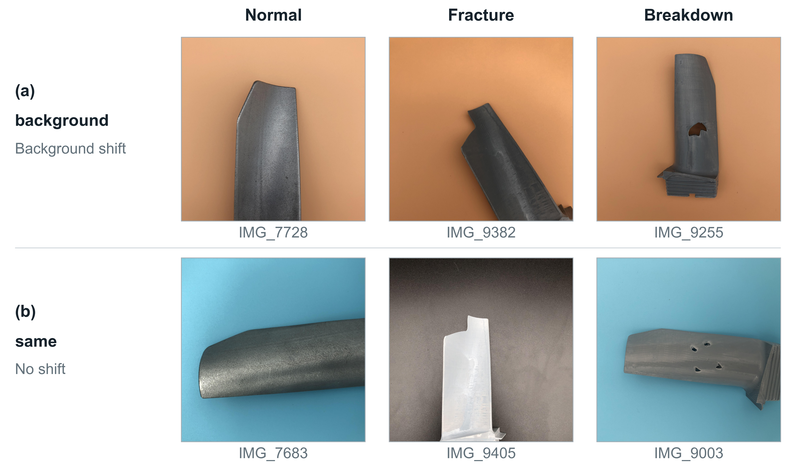
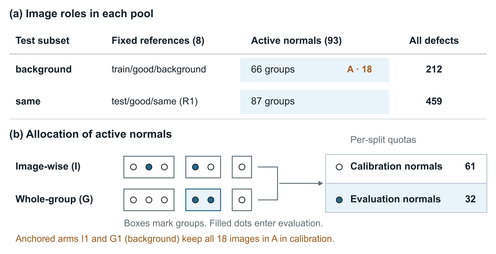
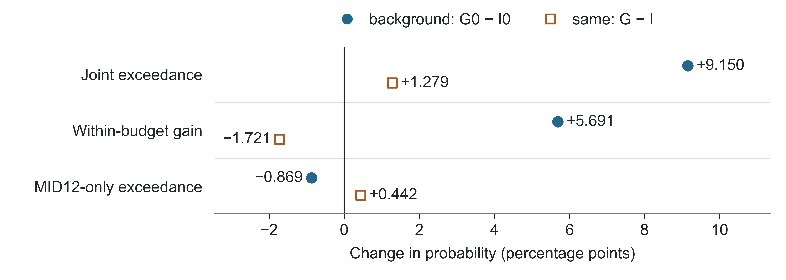
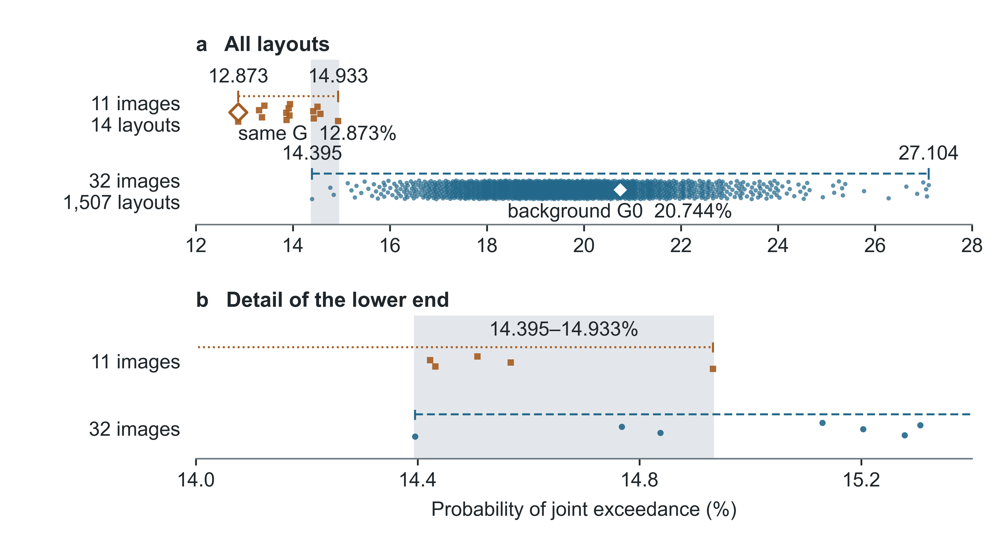

# Grouped Splits and False-Alarm Budgets in Few-Shot Anomaly Detection

Exact counting on two fixed-score pools

## Abstract

We quantify how keeping near-duplicate images together changes false-alarm budget outcomes in few-shot anomaly detection. We fix image scores in two AeBAD-S pools, the background-shift subset (background) and the unshifted subset (same). Each allocation splits 93 normal images into 61 for calibration and 32 for evaluation, with a budget of one false positive. We count all legal allocations for two thresholds, the largest calibration score (MAX) and the midpoint of the two largest (MID12).

Without a group reserved for calibration, whole-group assignment raises the probability that both rules exceed the budget from 11.59% to 20.74% in background and from 11.59% to 12.87% in same. When the two highest-scoring normals are singletons and outrank the third, this probability is a ratio of generating-function coefficients determined by the group sizes. Both pools meet these conditions. In same, the probability of MID12-only exceedance rises by 0.44 percentage points. The probability that MID12 detects more defects than MAX while meeting the budget rises by 5.69 percentage points in background and falls by 1.72 in same. These changes describe the two fixed pools.

**Keywords**　few-shot anomaly detection, false-alarm control, grouped splitting, exact counting, evaluation protocol

## 1 Introduction

### 1.1 Problem

Industrial anomaly detectors flag images whose scores exceed a threshold set using confirmed normal samples. An image-wise split can put near duplicates on opposite sides. For example, a high-scoring calibration image can raise the threshold enough to prevent its evaluation counterpart from triggering an alarm. The effect depends on the two scores and on how the threshold is set.

Whole-group splitting puts all images in a group on the same side. Even with the detector and scores held fixed, this changes which calibration and evaluation sets are possible. We compare the two approaches under a quota of 32 evaluation normals out of 93. With one false positive allowed, the allocation of a single high-scoring normal can decide whether the budget is met.

### 1.2 Scope and contributions

We derive an exact counting procedure for four outcomes that distinguish false-alarm budget exceedance from additional defect detections within budget. Under a rank condition satisfied by both AeBAD-S pools, joint exceedance reduces to the inclusion of two specified singleton groups. A generating function gives its probability from the group sizes and quantifies sensitivity to alternative layouts. The two pools show that the change in within-budget gain can have opposite signs under the same budget and threshold rules.

## 2 Related work

Table 1 relates this study to work on few-shot detection, population false-alarm calibration, and reference-bank contamination. We keep the scoring method fixed and measure how the feasible calibration and evaluation allocations affect image-level threshold outcomes.

**Table 1** Related work and the scope of this study

| Work | Focus | Role in this study |
|---|---|---|
| AnomalyDINO [2] | Few-shot anomaly detection with frozen DINOv2 features | Supplies the fixed scoring pipeline |
| Distribution-free false-alarm calibration [5] | Population false-positive targets and calibration sample sizes | Provides a comparison with the finite-pool budget in Section 3.4 |
| When More References Hurt [6] | Anomalous content mixed into reference banks | Addresses reference-bank contamination, a different question from near-duplicate grouping across the calibration and evaluation sets |

## 3 Protocol

### 3.1 Pools and roles

AeBAD-S contains images of individual aero-engine blades in a simulated inspection setting. The specimens are real blades or full-scale replicas. Training images cover different camera positions and black, gray, and blue backgrounds. The original study defines four defect classes: foreign-object damage (`breakdown`), hot-gas damage (`ablation`), missing blade regions (`fracture`), and edge grooves associated with cyclic loading (`groove`). [1]

We use two official test subsets. The normal examples in `same` are defined to follow the training distribution. The `background` subset introduces a change in the image background. The local counts agree with Table 1 of the dataset paper [1]. The 521 training normals comprise 265 `background`, 62 `illumination`, and 194 `view` images. The normal/defect counts for the four test subsets are 230/459 (`same`), 93/212 (`background`), 75/198 (`illumination`), and 92/280 (`view`). We evaluate all defects in the two selected subsets and assign the normal images to the roles shown in Table 2. The original image files were used as released. The [dataset license](https://github.com/zhangzilongc/MMR/blob/master/LICENSE-DATASET) is CC BY 4.0, and the [companion MMR code license](https://github.com/zhangzilongc/MMR/blob/master/LICENSE) is Apache-2.0.

**Table 2** Construction of the two score pools

| Role | `background` | `same` |
|---|---|---|
| Eight reference images | `train/good/background` | Held out of `test/good/same` under R1 |
| Active normal images `U` | 93 images in 66 groups | 93 images in 87 groups |
| Calibration / evaluation normals | 61 / 32 | 61 / 32 |
| Unused normals from the listed source | 257 training-side background normals | 129 reserve normals |
| Reference-neighbor group `A` in `U` | 18 images fixed in calibration for I1 and G1 | Empty. Two extra images in the reference closure are in reserve. |
| Defects (TP denominator) | 212 | 459 |
| Scoring manifest | 313 rows (305 queries + 8 references) | 560 rows (552 queries + 8 references) |

The training and test directories with matching names represent different settings. The three shifted test subsets are unseen during official training. [1] The eight `background` references thus come from the pre-shift domain. The active pool contains a connected component `A` of 18 normals close to the references under dHash. In `same`, the eight references come from the test subset under R1, and the two other images in their closure enter the reserve. The 8/61/32 role sizes are common to both designs. Reference sources, anchor sets, and defect counts differ, so cross-pool comparisons are descriptive (Section 6.4).

Figure 1 shows normal blades and two defect classes from the two official test subsets.



**Figure 1** AeBAD-S test examples. (a) Background-shift subset (`background`). (b) Unshifted subset (`same`). Each row shows a normal blade, a fracture, and foreign-object damage (breakdown), from left to right. Original image IDs appear below the samples. Images are from AeBAD-S by Zhang et al. [1], licensed under [CC BY 4.0](https://creativecommons.org/licenses/by/4.0/) and resized proportionally.

### 3.2 Grouping and arms

We convert each normal image to grayscale and resize it to 9 × 8 pixels using bilinear interpolation. The 64 left-to-right intensity comparisons define its difference hash (dHash). We connect images whose hashes differ in at most four bits and take connected components. The `background` active pool has 66 groups, comprising 61 singletons and five groups of sizes 2, 3, 3, 6, and 18. In `same`, we intersect the components of the full 230-image normal graph with the active set. This retains connections through reserve images and yields 87 groups, comprising 82 singletons, four pairs, and one triple.

The `same` active pool has only three direct dHash edges. Two of its multi-image groups connect only through reserve images. If components are recomputed on the active images alone, there are 90 groups (87 singletons and three pairs). The probability in Section 5.3 then changes from 12.872993% to 12.186741% (−0.686252 percentage points). The full-graph rule was fixed in the 9a feasibility audit before `same` scoring. The sensitivity is comparable in magnitude to the MID12-only contrast (+0.441996 percentage points, Section 5.2).



**Figure 2** Pool construction and allocation rules. (a) Fixed references, active normals, and defect images in the two pools. Reserve images in `same` can connect active images into the same group. (b) Boxes mark groups, and filled and hollow dots indicate evaluation and calibration, respectively. Image-wise arms (I) may split a group. Whole-group arms (G) keep each group on one side. Each split uses 61 calibration normals and 32 evaluation normals. Anchored arms I1 and G1 in `background` hold the 18 images in `A` in calibration.

**Table 3** Arms and allocation counts

| Arm | Selection unit | Eval. size | Anchor | Number of allocations |
|---|---|---:|---|---|
| I0 / I | Image | 32 | None | C(93,32) = 8661069563374624785150762 |
| G0 / G | Group | 32 | None | `background` 1672489259948266974; `same` 227171998760621646929754 |
| I1 (`background`) | Image (75 eligible) | 32 | A in calibration | C(75,32) = 1560606121612265215950 |
| G1 (`background`) | Group (65 eligible) | 32 | A in calibration | 1672464128242708178 |

Figure 2 shows evaluation eligibility. Table 3 gives the counts of legal allocations for the selection units and anchor constraints. Within a pool, the uniform distribution over unanchored whole-group allocations is the uniform distribution over unanchored image-wise allocations conditioned on preserving every group. The primary `background` comparison is G1 versus I1. The cross-pool comparison uses G0 versus I0 in `background` and G versus I in `same`.

### 3.3 Threshold rules and outcomes

For each allocation, we apply the rules in Table 4 to the 61 ordered calibration scores `x_1 ≤ … ≤ x_61`, then use the 32 evaluation normals and all defects to assign the outcome.

**Table 4** Thresholds and outcome assignment

| Item | Definition |
|---|---|
| MAX | `x_61` |
| MID12 | `(x_60 + x_61) / 2` (addition before division) |
| Alarm | `score > threshold` |
| FP / TP | Alarms among evaluation normals / defects, with denominators 32 / \|D\| |
| Outcome, in order | FP(MAX) ≥ 2: `both_over`. Else FP(MID12) ≥ 2: `mid_over`. Else ΔTP > 0: `budget_gain`. Else `budget_no_gain`. |

The budget is FP ≤ 1. The quantity ΔTP = TP(MID12) − TP(MAX) counts extra detections when lowering the threshold from the maximum to the midpoint of the two largest calibration scores. Both budget outcomes meet the false-positive constraint.

### 3.4 Exact counting

Every legal allocation is given equal weight within its arm. We order active normals by descending score, breaking ties by image key. Each allocation belongs to the class specified by its first two calibration images in that order. Once the pair is fixed, all images ranked before the second member, except for the first member, must be in evaluation. In a grouped arm this assignment applies to their entire groups. A class is infeasible if a group is forced to both sides or a calibration anchor is forced into evaluation.

The pair fixes both thresholds. The side of every normal that can exceed either threshold is fixed by the class, and the defect scores are fixed across allocations. All allocations in the class therefore share the same outcome. For each free unit of size s, include a factor (1 + x^s). The coefficient for the remaining evaluation quota counts the class's legal completions. We sum these integer counts by outcome and divide by the total number of legal allocations. Appendix A gives the coefficient recurrence.

We sample 10000 uniform allocations per arm for diagnostics. The sampled `background` I0 and G0 gain probabilities are 24.87% and 30.01%, a difference of +5.14 percentage points. The exact probabilities are 24.5357% and 30.2265%, a difference of +5.69 percentage points.

For a fixed scoring pipeline and n independent and identically distributed normal calibration examples, the one-sided 95%-confidence tolerance bound for the false-positive rate at the MAX threshold is 1 − 0.05^(1/n) [5]. With n = 61 it is 4.79%. A population target of 1/32 = 3.125% would require at least 95 independent calibration normals. In this study, 3.125% is an empirical budget on 32 evaluation normals. The exact allocation probabilities are conditional on the frozen finite pools.

## 4 Scoring and verification

### 4.1 Scoring

Both pools use AnomalyDINO [2] retrieval with DINOv2 ViT-S/14 features [3]. We resize the short side of each image to 448 pixels. CPU FAISS [4] retrieves one nearest neighbor per patch (k = 1), and the image score is the mean of the largest 1% of patch distances. Each pool uses the same eight references across all allocations.

### 4.2 Isolation and independent checks

In `same`, image keys and SHA-256 digests establish exact-image separation between roles. Two additional normals belong to the dHash reference closure and enter reserve. This leaves 220 eligible images, of which 93 are active and 127 join the two closure images in reserve.

The roles, graph, and allocation lists are fixed before reading scores. The planning audit records file-open events and whether scores were read. Evaluation verifies the plan digests and each allocation record before loading the scores. Two implementations of the `same` evaluation agree on all 620022 comparisons (20000 rows × 31 fields plus 22 exact fields). A full replay reproduces four evaluation outputs byte for byte. The `background` check compares 400000 fields across 40000 rows. Appendix B identifies the inputs and audit records.

## 5 Results

### 5.1 Four arms in `background`

The pool contains 93 active normals, eight references, and 212 defects (38 ablation, 60 breakdown, 67 fracture, and 47 groove).

**Table 5** Exact outcome probabilities in `background` (%)

| Arm | Selection units | Anchor | `budget_gain` | `budget_no_gain` | `mid_over` | `both_over` |
|---|---|---|---:|---:|---:|---:|
| I0 | 93 images | None | 24.5357 | 63.0008 | 0.8693 | 11.5942 |
| I1 | 75 images | A | 29.1796 | 52.9465 | 0 | 17.8739 |
| G0 | 66 groups | None | 30.2265 | 49.0292 | 0.0000118 | 20.7444 |
| **G1 (primary)** | 65 groups | A | **30.2267** | **49.0287** | **0** | **20.7446** |

From I1 to G1 (Table 5), within-budget gain rises from 29.179645% to 30.226656% (+1.047011 percentage points), and joint exceedance rises from 17.873874% to 20.744607% (+2.870733 points). Two independent integer counting procedures agree.

In I1 and G1, `mid_over` has zero probability. Whenever MAX meets the budget, at least one of the two highest-scoring normals is in calibration. The second-largest calibration score is then at least the anchor maximum, 0.5479057. The midpoint of this anchor maximum and the second-highest global score is 0.5860550, a lower bound for MID12 that exceeds the third-highest global normal score (0.5770623). At most one evaluation normal can exceed MID12. In G0, `mid_over` has positive probability (1.18365 × 10⁻⁷). Joint exceedance occurs precisely when both highest-scoring normals enter evaluation. For I1 it has probability 496/2775 = (32/75)(31/74).

G1 is G0 conditioned on A remaining in calibration. The probability of A entering evaluation in G0 is 1.5027 × 10⁻⁵. Conditioning out those allocations changes joint exceedance from 20.744368% to 20.744607%, an increase of 0.000239 percentage points.

### 5.2 Two arms in `same`

Of 230 normals, eight serve as references, 93 are active, and 129 are in reserve. The 459 defects comprise 60 ablation, 118 breakdown, 161 fracture, and 120 groove images. The false-positive and true-positive denominators are 32 and 459. The scoring manifest lists 552 evaluated queries and eight reference entries. Scoring excludes the reserve.

**Table 6** Exact outcome probabilities (%) and differences (percentage points) in `same`

| Outcome | I | G | G−I |
|---|---:|---:|---:|
| `budget_gain` | 85.546560 | 83.825774 | −1.720786 |
| `both_over` | 11.594203 | 12.872993 | **+1.278790** |
| `mid_over` | 2.859237 | 3.301233 | **+0.441996** |
| `budget_no_gain` | 0 | 0 | 0 |

Because `budget_no_gain` has zero probability under both arms (Table 6), the three contrasts satisfy the exact identity `δ_gain + δ_both + δ_mid = 0`. The only independent score-dependent contrast among these three is δ_mid, which depends on the position of the calibration midpoint and the evaluation-normal scores. The preregistered directional hypothesis H3 predicted a positive gain contrast. The observed contrast is negative, as the total exceedance probability rises by 1.720786 percentage points.

Across 20000 sampled splits, with 10000 per arm, every `both_over` label agrees with simultaneous evaluation inclusion of the two highest-scoring normals. All 126 allocations with ΔTP = 0 (56 in I and 70 in G) exceed the budget under both rules. MID12 is below MAX in every sampled allocation.

### 5.3 Joint exceedance across pools

The two top normals are separate singletons in both pools. In `background`, IMG_7771 and IMG_7773 score 0.673091090 and 0.624204201. In `same`, IMG_7814 and IMG_8005 score 0.524847567 and 0.521397537. In both, the second score strictly exceeds the third. If the two singleton groups are a and b, joint exceedance in the grouped arm occurs exactly when both are assigned to evaluation. The probability is

```
P(both) = [x^30] ∏_{g≠a,b} (1 + x^{s_g}) / [x^32] ∏_g (1 + x^{s_g})
```

Here s_g is the size of group g and [x^k] selects the coefficient of degree k. Each group contributes once to the product, including groups of equal size. The two layouts give 20.744368% in `background` (allocation count 1672489259948266974) and 12.872993% in `same` (227171998760621646929754). These are exactly the recorded fractions.

**Table 7** Descriptive cross-pool contrasts

| Contrast | `background` (G0−I0) | `same` (G−I) |
|---|---:|---:|
| Joint exceedance | +9.150165 pp | +1.278790 pp |
| Within-budget gain | +5.690767 pp | −1.720786 pp |
| MID12-only exceedance | −0.8693 pp | +0.441996 pp |

Under the verified rank conditions, the cross-pool difference in joint exceedance is determined by the two group layouts. The unanchored image-wise probabilities are both (32/93)(31/92) = 8/69, so the cross-pool difference comes entirely from the grouped arms. The +1.047011-point gain and +2.870733-point joint exceedance contrasts in `background` pertain to the anchored comparison G1−I1. The unanchored comparisons in Table 7 pair G0−I0 in `background` with G−I in `same`.

Figure 3 visualizes the three contrasts in Table 7. Joint exceedance rises in both pools. Within-budget gain and MID12-only exceedance each change in opposite directions across pools.



**Figure 3** Changes in outcome probability from image-wise to whole-group allocation in the unanchored arms. Filled circles show `background` G0−I0 and hollow squares show `same` G−I. The vertical line marks zero difference. Values are in percentage points, rounded to three decimal places. Table 7 gives the full numerical contrasts.

## 6 Discussion

### 6.1 Sensitivity to group layouts

There are 32 images in multi-image groups in `background` and 11 in `same`, leaving 61 and 82 singletons. With 93 images, 32 evaluation slots, and two specified singleton groups, we enumerate all unordered integer partitions of each multi-image total into parts of size at least two. The remaining images form singletons.



**Figure 4** Joint exceedance across layouts with fixed multi-image totals. (a) All enumerated layouts, with hollow diamonds marking the two observed layouts. (b) Detail of the lower end, with shading over the intersection of the two min–max ranges (14.395395%–14.932604%). Each point denotes a layout. Vertical offsets improve visibility, and patterned lines join the enumerated extrema. Each layout has 93 active normals and 32 evaluation slots. The two highest-scoring normals are singletons, and the second score strictly exceeds the third.

**Table 8** Enumeration at fixed multi-image totals

| Images in multi-image groups | Layouts | Probability range | Span |
|---:|---:|---|---:|
| 11 | 14 | 12.872993% (2,2,2,2,3) to 14.932604% (one group of 11) | 2.06 pp |
| 32 | 1507 | 14.395395% (16 pairs) to 27.103825% (one group of 32) | 12.71 pp |

The two ranges overlap in Figure 4. The extrema in Table 8 show that the 11-image maximum exceeds the 32-image minimum. The observed difference between pools is 7.87 percentage points, within the 12.71-point span among the 32-image layouts alone. The group count, largest group, and multi-image total are partial summaries of the layout.

The marginal inclusion probability for a singleton is 45.79% in `background` and 36.20% in `same`. Subtracting the squared marginal from the joint probability gives −0.2234 and −0.2339 percentage points, respectively, indicating slight negative association.

### 6.2 Implications for evaluation

A one-false-positive budget on 32 normal evaluation images makes high-scoring observations consequential. The two pools show opposite changes in within-budget gain. Reporting the evaluation quota, group sizes, and verified ranks and group memberships of the highest-scoring normals makes the joint exceedance calculation reproducible.

### 6.3 Scope of the R1 reference protocol

R1 uses eight normal references held out of `test/good/same`, giving access to additional test-side normal information. By the official definition [1], the 521 `train/good` normals are also a candidate source from the same distribution. Our result is conditional on the frozen R1 bank and the scoring pipeline.

### 6.4 Limitations

- **Reference source and dependence.** The eight references and the 93 active normals in `same` come from the same test subset. The 9a audit removes two other images in the dHash reference closure. Acquisition independence is unverified.
- **Domain shift.** The official labels define `same` as unshifted and `background` as background-shifted relative to training. Shift magnitude and its contribution to detection are beyond what this comparison identifies.
- **Near-neighbor proxy.** The dHash cutoff is a proxy for visual similarity. Similarity in DINO features and the resulting effects on false positives and gains require separate evaluation.
- **Multiple design differences.** The two pools differ in dataset subset, reference source, anchor set, and defect composition and sample size (212 versus 459). The observed cross-pool differences are descriptive.
- **Anchor eligibility.** Unanchored `background` splits allow the 18-image reference-neighbor component to enter evaluation, with probability 0.001503%. The `same` active set excludes the reference closure. Holding the background group out of evaluation changes joint exceedance by about 0.00024 percentage points.
- **Reserve-mediated connections.** Section 3.2 quantifies the effect of constructing the graph on the full pool or on the active set. The joint exceedance probability is conditional on the grouping convention.
- **Preregistered H4.** The signed inequality `δ_gain < +5.690767 pp` is automatically satisfied when the difference is negative. The finding that `|δ_gain| = 1.720786 pp < 5.690767 pp` is a post-hoc magnitude comparison.
- **Descriptive detection rates.** MAX gives mean detection of 20.82% in `same` I (95.5665/459, mean FP 0.5161) and 0.77% in `background` G0 (1.6233/212, mean FP 0.8003). These averages describe the respective reference banks, test subsets, arms, and defect pools.

### 6.5 Future work

A paired comparison within `same` could replace the frozen R1 bank with eight prespecified training normals. The image identity and neighbor exclusions would be fixed before reference selection, and the 93 active normals, 459 defects, grouping, allocation lists, and scoring configuration would be held fixed. Rescoring the 552 queries would allow comparison between the two specified banks on identical splits.

An image-only precheck showed that a uniform draw of eight from 521 training normals includes at least one direct neighbor of an active image with probability 27.04%. Excluding direct neighbors or their connected components leaves 501 or 486 candidates, respectively. Appendix B.4 reports the underlying graph and counts.

## 7 Conclusion

Whole-group splitting increases joint budget exceedance in both fixed-score pools. When the highest two normals are singletons and both outrank the third, the group sizes determine the exact probability. The layout enumeration shows substantial variation at a fixed total number of images in multi-image groups. Within-budget gain moves in opposite directions across the two pools. The gain estimates apply to the specified pools and allocation protocols.

## Data availability

The original AeBAD-S images are available from the Datasets section of the [official project repository](https://github.com/zhangzilongc/MMR#datasets) under [CC BY 4.0](https://creativecommons.org/licenses/by/4.0/). Appendix B indexes the study's role manifests, score tables, and exact-counting records.

## References

[1] ZHANG Z L, ZHAO Z B, ZHANG X W, et al. Industrial anomaly detection with domain shift: a real-world dataset and masked multi-scale reconstruction[J]. Computers in Industry, 2023, 151: 103990. DOI:10.1016/j.compind.2023.103990.

[2] DAMM S, LASZKIEWICZ M, LEDERER J, et al. AnomalyDINO: boosting patch-based few-shot anomaly detection with DINOv2[C]//Proceedings of the IEEE/CVF Winter Conference on Applications of Computer Vision. Piscataway: IEEE, 2025: 1319-1329. DOI:10.1109/WACV61041.2025.00136.

[3] OQUAB M, DARCET T, MOUTAKANNI T, et al. DINOv2: learning robust visual features without supervision[J]. Transactions on Machine Learning Research, 2024.

[4] JOHNSON J, DOUZE M, JÉGOU H. Billion-scale similarity search with GPUs[J]. IEEE Transactions on Big Data, 2021, 7(3): 535-547.

[5] DENG J. Distribution-free false-alarm calibration and chance-corrected spatial evaluation for industrial anomaly detection[EB/OL]. (2026-08-15)[2026-11-19]. https://arxiv.org/abs/2608.15090.

[6] KALANTARY H, KHORAMDEL J. When more references hurt: contamination-aware DINOv2 memory banks for few-shot steel defect detection[EB/OL]. (2026-08-25)[2026-11-19]. [arXiv:2608.22082v2](https://arxiv.org/abs/2608.22082v2).

## Appendix A. Closed form and enumeration

**A.1 Derivation.** A whole-group evaluation set consists of groups whose sizes sum to 32. When the two highest-scoring normals are singleton groups a and b and outrank the third score, selecting both makes FP(MAX) at least two. If either remains in calibration, at most one evaluation-normal score exceeds MAX. The denominator in Section 5.3 counts all allocations. Its numerator fixes a and b in evaluation and counts allocations of the remaining 30 slots. We compute the coefficients as integers by dynamic programming and keep the probabilities as exact fractions.

For a quota k, initialize c(0) = 1 and c(t) = 0 for t = 1, …, k. For each free unit of size s, update c(t) ← c(t) + c(t − s) for t = k down to s. The resulting c(k) gives the coefficient. Descending order ensures each unit is counted at most once in each allocation.

**A.2 Conditions.** Both pools have 93 active normals and 32 evaluation normals per allocation. The highest two scores are in singleton groups. Their lead over the third is strict. The top three scores are 0.673091090, 0.624204201, and 0.577062321 for `background` and 0.524847567, 0.521397537, and 0.518221307 for `same`.

**A.3 Layouts.** For a fixed multi-image total, enumerate unordered partitions with parts at least two and assign all remaining images to singleton groups. There are 14 layouts for a total of 11 and 1507 for 32.

**A.4 Identity.** In `same`, the exact zero probability of `budget_no_gain` in both arms and the exhaustive four-state partition give `δ_gain + δ_both + δ_mid = 0`.

## Appendix B. Reproduction index

**B.1 Records and results**

| Item | Project-relative record |
|---|---|
| `background` four exact states, G1−I1, inclusion of A | `week8/acceptance/stage8-arms-2026-11-06/exact-audit-v1.json` |
| `background` roles and counts, including 305 queries and 313 rows | `week7/acceptance/stage7-background-2026-11-05/roles-background-v1.json` |
| `background` exact-counting implementation | `week8/audit_arms_exact.py` |
| `background` image scores | `week7/outputs/background-448-r1/scores.csv` |
| `background` group layout and A (group 4) | `week8/acceptance/stage8-grouping-2026-11-06/groups-dh4.csv` |
| `same` four exact states and contrasts | `week9/acceptance/stage9b-eval-2026-11-18/exact-states.json` |
| `same` sampled rows and cross-pool statistics | `eval-rows.csv` and `eval.json` in the same directory |
| `same` roles, alignment, and plan audit | `pool-plan.json`, `plan-digest.json`, and `read-audit.json` in `week9/acceptance/stage9b-plan-2026-11-18-r2/` |
| `same` exact-counting implementations | `week9/same-pool-lab/src/pool.py` and `week9/same-pool-lab/reference_b.py` |
| `same` image scores and scoring parameters | `scores.csv`, `score-meta.json`, and `score-digest.json` in `week9/outputs/same-448-r1/` |
| Independent check, 620022 comparisons and zero discrepancies | `independent-crosscheck.json` in the `same` evaluation directory |
| Layout enumeration spans, 2.06 and 12.71 percentage points | Sections 5.3 and 6.1, Appendix A.3 |
| AeBAD-S splits, counts, and license | Table 1 of [1], the official project repository, and `week9/stage9c-dataset-provenance-2026-11-19.md` |

**B.2 Verification order.** Recompute the digests in the frozen plan, validate each allocation record, then read scores and reproduce the four states and the closed form. Compare with the recorded values.

**B.3 Integrity records.** The two study stages have 81 and 80 registered files, respectively. All 161 recorded file sizes and SHA-256 digests were verified. The Stage 8 acceptance suite passed 24/24 checks, with additional guard suites passing 15/15 and 18/18. For `same` scoring, CPU FAISS ran in a separate process to isolate the OpenMP runtime. A synthetic retrieval check matched byte for byte.

**B.4 Training-reference precheck.** There were no exact duplicates by SHA-256 between the 521 training normals and 230 `same` test normals. The 73 cross-set pairs at dHash distance at most four involved 25 test normals, including 10 active images. Excluding the 20 training normals directly adjacent to an active image leaves 251, 60, and 190 candidates from training-side background, illumination, and view, respectively. On the joint graph of 751 normals, excluding training normals in any component that contains an active image leaves 239, 59, and 188. Of the 15 additional exclusions, nine come from one 31-image component with 18 training normals and 13 test normals. The latter include three active images, IMG_7683, IMG_7908, and IMG_8058, linked by reserve images. The same near-neighbor structure contributes to the sensitivity in Section 3.2.

## Appendix C. Notation

| Symbol | Meaning |
|---|---|
| U | Active set of 93 normal images |
| A | Component of 18 test normals close to references in `background`, held in calibration in I1 and G1 |
| E | U minus A (75 images) |
| I / G | Image-wise / whole-group assignment |
| x_1…x_61 | Ordered calibration scores in one split |
| `both_over` | Both MAX and MID12 exceed FP = 1 |
| `mid_over` | FP(MAX) ≤ 1 and FP(MID12) ≥ 2 |
| `budget_gain` | Both meet the budget and ΔTP > 0 |
| `budget_no_gain` | Both meet the budget and ΔTP = 0 |
| R1 | Eight references held out of the test-normal subset in `same` |
